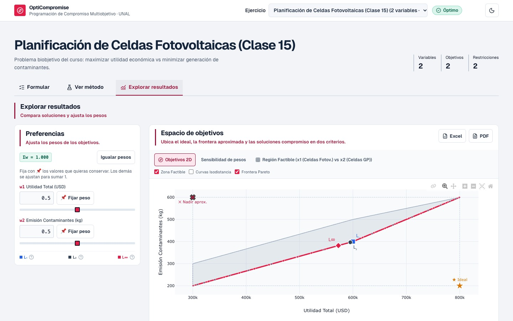
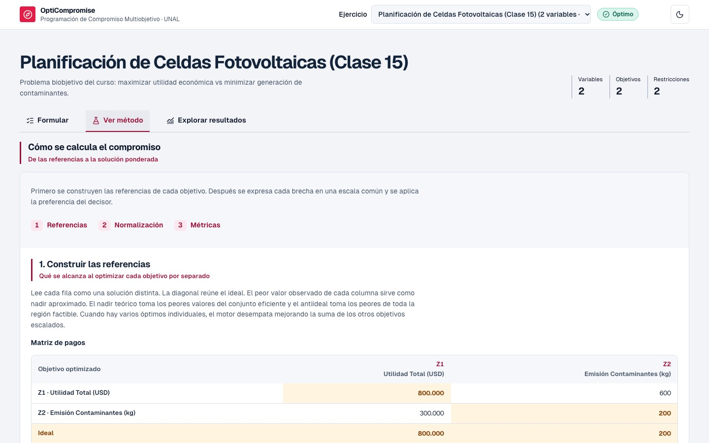
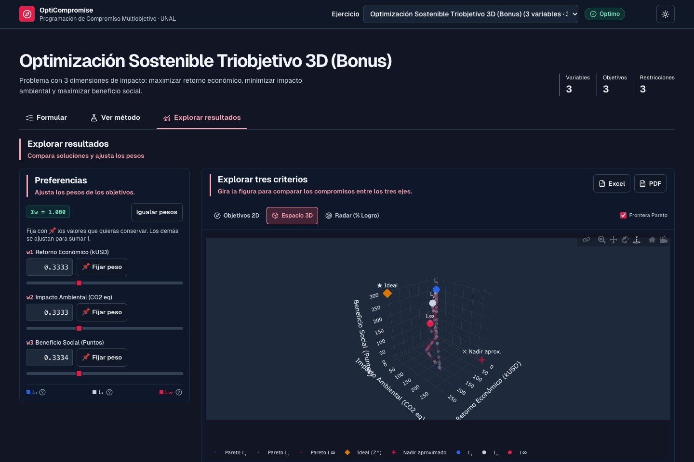

# Guía de la interfaz actual

## Formular un modelo

1. Al abrir la aplicación se carga el caso base de *Celdas Fotovoltaicas*. Para abrir cualquiera de los 6 casos del curso, entra en **Formular**, pulsa **Cargar ejercicio** y selecciona un libro `.xlsx` de la carpeta [`ejercicios/`](../ejercicios/). Para empezar desde cero, pulsa **Nuevo modelo**; para armar tu propio archivo, pulsa **Obtener plantilla (.xlsx)**, diligencia la hoja **Modelo** y ábrelo con **Cargar ejercicio**. Consulta la [guía docente](guia-docente-ejercicios.md) para ver los campos admitidos.
2. En **Formular**, define las variables (tipo continua ℝ, entera ℤ o binaria {0,1} y cotas), agrega dos o más objetivos (Max/Min) y registra las restricciones con `≤`, `≥` o `=`.
3. Puedes editar coeficientes en **Modo Tabla** o escribir ecuaciones directamente en **Modo Algebraico**. **Resolver**, **Aplicar Ecuaciones y Resolver** y el cambio a otra vista aplican el borrador si las ecuaciones son válidas. Si hay errores, el texto se conserva y se indica qué corregir. Si las cotas son incompatibles, vuelve a **Modo Tabla** para corregirlas con el borrador pendiente y luego aplica las ecuaciones. El nombre, la descripción y la fuente se desbloquean al aplicar o descartar el borrador. Puedes usar **Descartar borrador** para recuperar el texto del modelo aplicado. Cada ecuación determina las variables presentes. **Modo Tabla** permite editar tipos y cotas.
4. Si el modelo es infactible, revisa qué restricciones y cotas son incompatibles. Si está no acotado, revisa qué objetivo puede mejorar indefinidamente. Cuando una edición invalida un ejercicio que ya resolviste, usa **Restaurar último modelo válido** para recuperar su formulación y pesos.

## Explorar e interpretar

1. En **Preferencias**, escribe un peso (admite coma o punto decimal) o usa su deslizador. Pulsa **📌 Fijar peso** para conservar su valor al ajustar los demás. Si solo queda un peso libre, toma el valor necesario para que la suma sea 1. **Igualar pesos** asigna el mismo valor a todos. Si hay un peso fijado incompatible, desbloquéalo antes de igualar.
2. En **Explorar resultados**, identifica en **Objetivos 2D** el punto ideal, el nadir aproximado, las curvas de isodistancia, la zona factible y las tres soluciones. Abre **Guía de curvas de isodistancia** para leer qué representa cada forma. Elige **Región Factible** cuando haya dos variables (incluyendo malla discreta MIP) o **Espacio 3D** y **Radar (% Logro)** cuando existan tres o más objetivos.
3. En modelos de dos objetivos, abre **Sensibilidad de pesos** para comparar la desviación al ideal de $L_1$, $L_2$ y $L_\infty$ en 21 pesos entre 0 y 1. La línea punteada sigue el peso seleccionado y los marcadores grandes muestran el último cálculo del motor.
4. En **Comparación de soluciones** y **Valores de las variables**, revisa qué gana y qué cede cada métrica y traduce los valores óptimos de las variables a decisiones concretas.
5. En **Ver método**, usa el índice para saltar a *Referencias*, *Normalización* o *Métricas*. La matriz de pagos incluye el ideal y el nadir aproximado como referencias, junto con consultas avanzadas y **Ver restricciones minimax con los datos del modelo**.

## Copiar y descargar resultados

**Copiar para informe**, al inicio de **Explorar resultados** junto a **Excel (.xlsx)** y **PDF**, lleva al portapapeles los pesos, la matriz de pagos, el ideal y el nadir, las distancias y los valores por objetivo y variable. Al pegar, un editor puede usar las tablas en HTML o el texto en Markdown.

- **Excel (.xlsx)** reúne la ficha del modelo, la matriz de pagos, L₁, L₂ y L∞, los valores y brechas por objetivo y las muestras Pareto cuando existen. Cada gráfica se incrusta en su propia hoja. La hoja **Modelo** se puede volver a abrir con **Cargar ejercicio**. La aplicación asigna el dominio [0, 1] a las binarias al cargar el archivo.
- **PDF (.pdf)** presenta la identificación, la formulación matemática, las tablas de resultados y las gráficas con sus leyendas.
- Ambos incluyen la proyección 2D con Pareto e isodistancias cuando aplican, la región de decisiones si hay dos variables, la sensibilidad si hay dos objetivos, y las vistas 3D y radar a partir de tres objetivos. Las gráficas se incluyen aunque no hayas abierto sus pestañas. La aplicación y el informe identifican las imágenes que no se pudieron generar.

Al recargar, el navegador conserva la última sección activa. Los manuales están en el pie de página. Si un archivo o ejemplo falla al cargar, la alerta conserva el modelo y la sección abiertos.

| Concepto | Lectura |
|---|---|
| Ideal | Vector con el mejor valor de cada objetivo, calculado por separado. |
| Nadir aproximado | Peor valor de cada criterio entre las filas de la matriz de pagos. |
| Logro | 100 % en el ideal. Con rango de pagos positivo, corresponde 0 % al peor valor de pagos y un logro negativo a un desempeño peor. |
| Frontera aproximada | Alternativas de la muestra para las que ninguna otra de la muestra mejora un criterio sin empeorar otro. |
| $L_1$ / $L_2$ / $L_\infty$ | Suma de brechas ponderadas, raíz de la suma de los cuadrados de las brechas ya ponderadas y mayor brecha ponderada, respectivamente. |
| Resultado parcial | Alguna métrica quedó sin verificación de optimalidad. Si existe un candidato factible, la aplicación lo identifica como tal. |

## Capturas del recorrido

**Explorar resultados en escritorio.** El espacio de objetivos muestra la región proyectada, el ideal, el nadir, las muestras del barrido de Pareto y las tres soluciones. Las preferencias se pueden modificar sin abandonar el gráfico.

**Ver método.** La matriz de pagos muestra qué se consigue al optimizar cada criterio por separado. Debajo se usa el rango de referencia para comparar unidades distintas.

**Modelo triobjetivo.** Selecciona **Espacio 3D** para girar el gráfico y ver la relación entre los tres criterios.

[Vista móvil de 390 px después de usar Ir al gráfico](capturas/opticompromise-movil.jpg)
